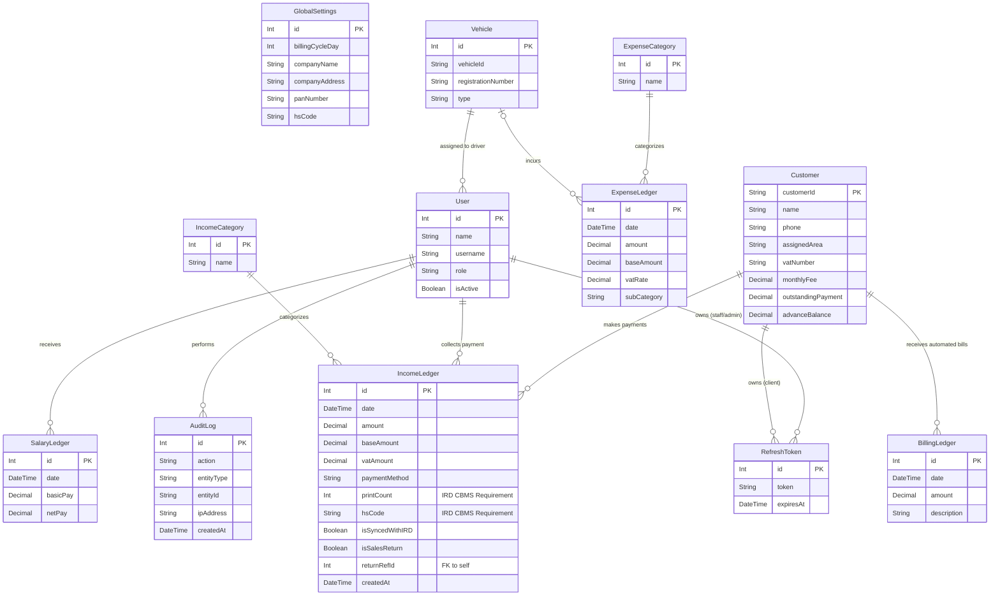

# Godawari Waste Management - Database ER Diagram

This document contains the Entity-Relationship (ER) diagram for the Godawari Waste Management system, showing the strict relational architecture required for CBMS compliance (specifically the immutable `IncomeLedger` and its relationships).

## Entity-Relationship Diagram

## Non-Deletable Bill Enforcement (Immutability)

To comply with the IRD Computerized Billing System (CBMS) requirements, the `IncomeLedger` table is strictly protected by PostgreSQL database-level triggers.

1. **`prevent_income_ledger_update`:** Any `UPDATE` statement executed against the `IncomeLedger` table is immediately rejected by the database engine.
2. **`prevent_income_ledger_delete`:** Any `DELETE` statement executed against the `IncomeLedger` table is immediately rejected by the database engine.

Errors in billing must be corrected by creating a **Credit Note (Sales Return)**, which generates a new compensating transaction referencing the original ID (`returnRefId`), preserving the complete, immutable historical audit trail.
